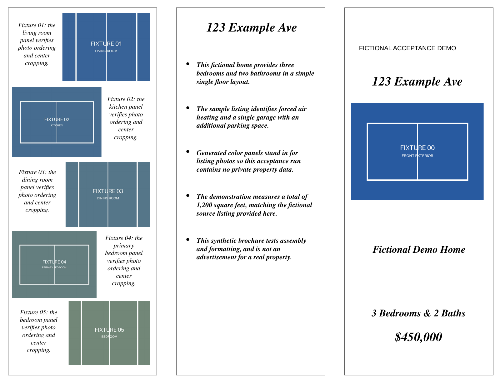
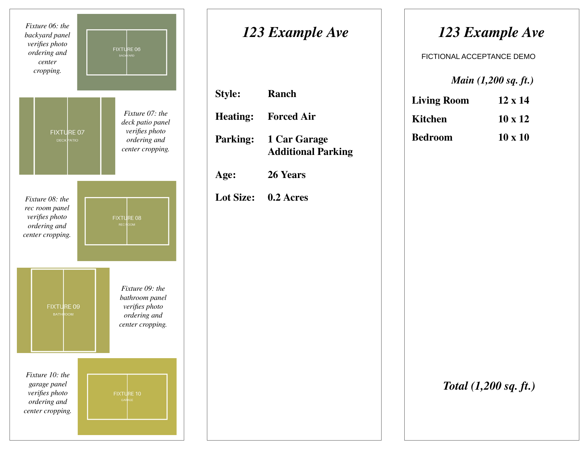

# Brochure-Agent

Turn a real-estate listing PDF and a folder of property photos into an editable PowerPoint brochure, using an existing layout.

The project addresses the repetitive work between a listing sheet and a finished brochure: extract property details, organize room measurements, choose a useful sequence of photos, write short copy, and fit those pieces into the template. The model interprets the inputs; Python handles selection rules, text cleanup and presentation assembly. The PowerPoint template remains the starting point for the visual design and final manual edits.

## How it works

The desktop UI and CLI use the same [pipeline](brochure_agent/pipeline.py):

1. **Read the listing.** `pypdf` extracts text, then an OpenAI structured response supplies address, price, bedrooms/bathrooms, features, floor areas and room sections. Python cleanup recognizes listing-sheet conventions and normalizes the feature and room blocks.
2. **Assess the photos.** Supported files in the selected folder are converted to JPEG thumbnails and analyzed in batches of eight. The response identifies scene types, front exteriors, quality scores and images to avoid.
3. **Select a brochure sequence.** The [selection rules](brochure_agent/parsing.py) prefer a front exterior for the main image, then choose up to ten gallery photos. Scene weights favor living spaces and kitchens; diversity rules reduce repeated bedrooms and exterior views before a fallback fills remaining slots. This keeps an attractive view from dominating the whole brochure merely because it scored highly.
4. **Write the copy.** A separate request generates a title, summary bullets and captions tied to exact photo filenames, using the extracted facts and selected-image descriptions.
5. **Fill the presentation.** [Rendering](brochure_agent/rendering.py) replaces text and named image slots, crops photos to their boxes, and formats summary, feature and room blocks. The result is a `.pptx` file for review and editing.

The CustomTkinter GUI runs generation in a background thread and displays queued progress messages. Recent development moved from room formatting, wording and photo selection to the GUI and Windows launch helpers; the May 2026 stopping point was packaging the tool for use.

## Inputs and template contract

Provide a PDF with extractable text, a photo folder, a template and an output path. Supported photo extensions are `.jpg`, `.jpeg`, `.png`, `.webp` and `.gif`; folder scanning is not recursive. WebP photos are embedded as PNG because PowerPoint assembly does not support WebP directly; animated WebP uses its first frame. Original filenames still identify captions. Image-only scanned PDFs fail with a no-extracted-text error because OCR is not implemented.

Start with [`Brochure_Template.pptx`](Brochure_Template.pptx). Its text placeholders are:

| Content | Placeholder |
| --- | --- |
| Property heading | `{{ADDRESS}}`, `{{PRICE}}`, `{{BEDS_AND_BATHS}}`, `{{TITLE}}` |
| Main text sections | `{{SUMMARY}}`, `{{FEATURE_BLOCK}}`, `{{ROOM_BLOCK}}`, `{{TOTAL}}` |
| Gallery captions | `{{caption_1}}` through `{{caption_10}}` |

Image placeholders are identified by **shape name**, rather than visible text: `{{IMG_MAIN}}` and `{{IMG_1}}` through `{{IMG_10}}`. Preserve those names when adapting the template. Text replacement handles placeholders split across PowerPoint XML runs. Summary, feature and room blocks have custom layout rules, so a substantially different template needs visual checking.

## Setup

Use Python 3 with the packages in [`requirements.txt`](requirements.txt). From the repository root, create and activate a virtual environment, then install them:

```bash
python -m venv .venv
# Linux/macOS activation; Windows users can use the helpers below.
source .venv/bin/activate
python -m pip install -r requirements.txt
```

Set `OPENAI_API_KEY` in the environment used to launch the app:

```bash
export OPENAI_API_KEY=your_key_here
```

`OPENAI_BASE_URL` optionally selects a compatible endpoint. The application reads environment variables directly; it does **not** automatically load a `.env` file. The default model configured in [models.py](brochure_agent/models.py) is `gpt-5.5`. Choose another model in the GUI or with `--model` if needed; the configured service must support image inputs and the structured Responses requests used by the code.

Tkinter normally comes with the Windows Python installer. On Linux, GUI use may require the OS Tk package (`sudo apt install python3-tk` on Ubuntu/Debian, or `sudo pacman -S tk` on Arch/EndeavourOS). CLI use does not require opening a Tk window.

## Run

Open the desktop interface from the repository root:

```bash
python main.py
```

Choose the listing PDF, image folder, template, output `.pptx` and model, then start generation. On Windows, `run_gui.pyw` can also launch the GUI with a suitably configured Python environment.

For explicit command-line mode:

```bash
python main.py --cli \
  --pdf "/path/to/listing.pdf" \
  --images "/path/to/image-folder" \
  --template "Brochure_Template.pptx" \
  --output "/path/to/output-brochure.pptx"
```

Without `--cli`, the app attempts the GUI first. If that is unavailable, it can use the supplied PDF/image arguments for CLI mode; launching with no inputs instead reports the GUI error. Relative paths are resolved from the working directory. Generation creates the output directory if necessary and saves to the chosen filename, replacing an existing file at that path.

## Windows install and updates

1. Install Python from `python.org` and check `Add python.exe to PATH`.
2. Install Git for Windows.
3. Clone this repo.
4. Double-click `Setup.bat`.
5. Double-click `Set_API_Key.bat` once and paste the OpenAI API key.
6. Double-click `Run_Brochure_App.bat` to open the app.

`Setup.bat` creates `.venv` and installs dependencies. `Set_API_Key.bat` stores the key in the Windows user's environment; reopen the app afterward. `Update.bat` performs a fast-forward Git pull and refreshes dependencies. Keep a working copy of any customized template before updating it.

## Review the generated brochure

Generation sends extracted listing text and photo thumbnails to the configured model service and can incur API charges. Files remain available locally, but the interpretation stages are not an offline workflow. Git ignores listing PDFs, common input/output folders, environment files and common generated-brochure names; an arbitrary output filename is not necessarily ignored.

Structured responses ensure usable fields, not factual correctness. Compare the generated address, price, measurements, claims and selected photos against the inputs, and check text overflow and cropping in PowerPoint. Cleanup is tailored to particular listing-sheet patterns. Property age uses the current calendar year on the computer running the app minus the extracted year built; a future construction year is omitted rather than shown as a negative age.

The CLI/GUI and pipeline are implemented. Offline assembly and visual checks are described below; live model behavior and the intended Windows installation remain unverified.

## Tests

After installing the dependencies, run the regression tests from the repository root:

```bash
python -m unittest discover -s tests -v
```

These tests cover property-age cleanup, including calendar-year rollover and future construction dates, plus offline integration and input failures. They run locally without an API key or model requests.

## Offline acceptance demonstration

After installing `requirements.txt`, this one command runs the **existing CLI and
pipeline** with generated listing text/PDF, twelve synthetic image panels and
mocked structured model responses. It needs no key and blocks socket connections:

```bash
python -m tests.offline_acceptance
```

It writes `outputs/offline-acceptance/acceptance.pptx`, the source fixtures and a
`report.json`. Checks cover the two-slide deck, exact field mapping, one main and
ten unique gallery photos, excluded photos, filename-associated captions (mock
responses deliberately arrive in reverse order), slot positions, valid crop
fractions and unresolved placeholders. This demonstrates assembly, not model
accuracy or the quality of real property photos.

The demo derives its layout from the supplied template, preserving its text
styles and placeholder geometry. It replaces the raster backgrounds with plain
fictional-demo backgrounds: the supplied backgrounds contain agency branding,
a portrait, an old MLS number and a measurement-source claim. **These are baked
into images, not editable text placeholders.** Before using the original template
for another listing, replace those backgrounds in PowerPoint and verify all
remaining boilerplate. The test suite also exercises the unmodified template.




Optional PDF export for visual review, with LibreOffice installed:

```bash
libreoffice --headless --convert-to pdf --outdir outputs/offline-acceptance \
  outputs/offline-acceptance/acceptance.pptx
```

On Linux where the desktop CLI cannot start, the included LibreOfficeKit helper
uses the same installed office engine without desktop IPC:

```bash
python -m tests.render_acceptance \
  outputs/offline-acceptance/acceptance.pptx \
  outputs/offline-acceptance/acceptance.pdf
# Optional: pass --install /path/to/libreoffice/program
pdftoppm -scale-to 1600 -png outputs/offline-acceptance/acceptance.pdf \
  outputs/offline-acceptance/slide
```

The committed previews were exported using LibreOfficeKit 26.2.5.2 and Poppler.
Both pages were visually inspected with representative 73–82 character captions:
text was readable without overlapping neighboring panels, center cropping kept
the fixture labels visible, and no dynamic placeholders remained. The normal
LibreOffice CLI exited with status 1 in the test sandbox; the Kit helper succeeded.
Font substitution and PowerPoint layout can differ. Arbitrarily long input is not
covered by this visual check and still requires manual review.

Input preflight now rejects missing/empty photo folders, unreadable photos,
unreadable/textless PDFs and missing, unknown or duplicate image template slots
before creating a model client. The fixed template contract requires all listed
text and image placeholders even for a sparse gallery. Unused gallery slots are
covered in white so old background imagery cannot show through.

Verified on Linux/Python 3.14.7 with python-pptx 1.0.2, Pillow 12.2.0, pypdf 6.10.2,
pydantic 2.13.3 and openai 2.32.0: 22 unit/integration tests (including a WebP
photo through the full mocked pipeline), the offline command,
CLI help/error paths and Python compilation. Eight existing property-age tests
remain unchanged. No live model requests were made. Windows launch helpers were
reviewed, but a Windows Python installation and the Tk GUI were not executed.
